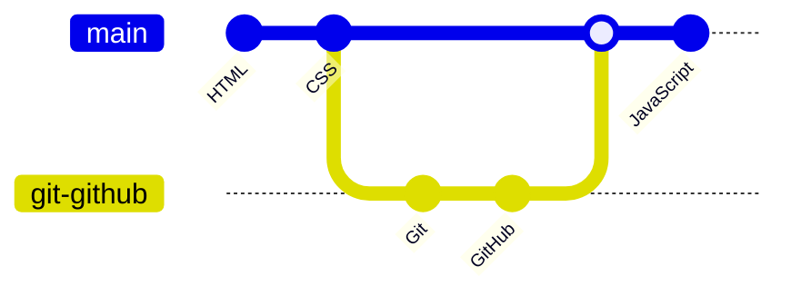

## 👋 ¡Hola! Soy Jhonger

Venezolano y Licenciado en Ciencias y Artes Militares, mención **Operaciones Aeroespaciales**.
Hoy llevo esa disciplina a un nuevo cielo: **el desarrollo web**.

- 🔭 Estoy construyendo mi **portafolio web**
- 🌱 Estoy aprendiendo **Git, GitHub y JavaScript**
- ✈️ Formación en **operaciones aeroespaciales**
- 🥋 **Cinturón marrón** de Karate Do
- 🌎 Idiomas: **español** (nativo) e **inglés** (básico)

## 🛠️ Tecnologías y herramientas

  
  
  
  
  
  
  
  

## 🗺️ Mi ruta de aprendizaje

## 📫 Vías de contacto

  
    
  

<!---->

